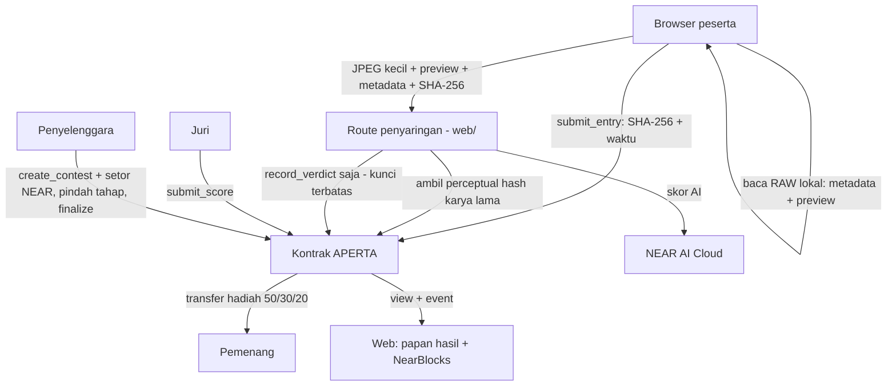
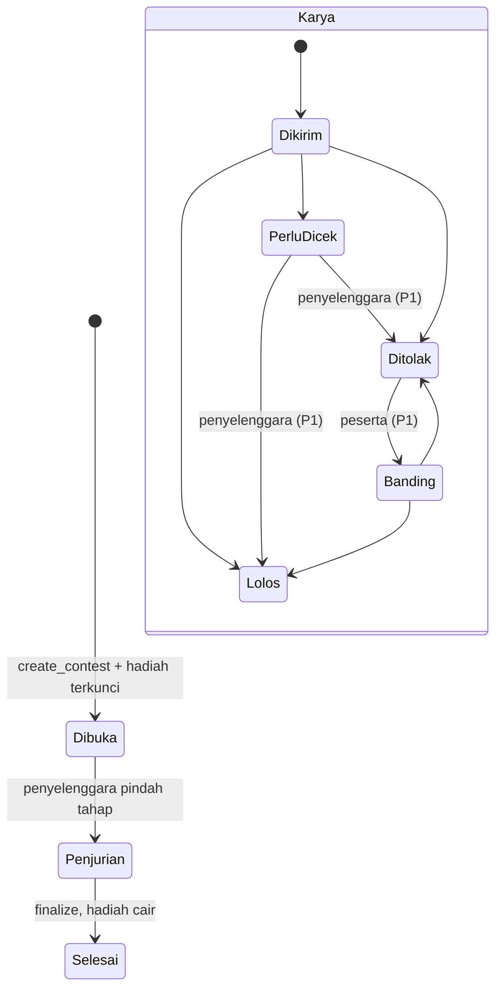

# APERTA - Plan

Dokumen ini satu-satunya sumber kebenaran untuk proyek solo APERTA (NEAR HACKATHON "Build Beyond Boundaries").
Setiap sesi Claude Code wajib membaca file ini sebelum menulis kode.
Kalau file lain bertentangan dengan file ini, file ini yang menang, lalu tanyakan ke Dilly.

---

## Goal Capsule

- **Objective:** Juri membuka demo online, menjalankan satu lomba foto dari awal sampai hadiah cair, dan melihat sendiri bahwa foto AI ditolak, foto curian ditandai beserta pemilik aslinya, dan hadiah dibayar otomatis ke pemenang, dengan link NearBlocks untuk setiap langkah.
- **Means:** Kontrak Rust di NEAR testnet yang mengunci hadiah dan mencatat karya, hasil penyaringan, dan nilai juri (KTD1–KTD3). Agen penyaring dengan kunci terbatas (KTD4–KTD7). Web Next.js dengan mode demo juri (KTD8).
- **Authority:** PLAN.md > `contract/INTERFACE.md` > kode. Data demo di R1–R3 terkunci.
- **Execution profile:** satu orang (Dilly) + Claude Code. Commit langsung ke `main`, tanpa branch dan tanpa PR.
- **Prioritas:** P0 harus jalan online dulu, baru P1, lalu P2. Lihat "Urutan prioritas dan pemotongan".
- **Stop conditions:** berhenti dan tanya Dilly jika (a) harus mengubah data demo R1–R3, (b) diminta memakai mainnet atau uang asli, (c) P0 belum online tapi tergoda mengerjakan P1/P2, (d) jam Sabtu 15.00 WIB lewat dan APERTA belum online (waktunya video FULLBACK).
- **Deadline:** submit Sabtu 14 Nov 2026 23:59 UTC = Minggu 15 Nov 06:59 WIB. Target submit Sabtu 22.00 WIB.
- **Batas proyek:** maksimal 2 proyek per orang. APERTA adalah proyek kedua Dilly setelah FULLBACK (tim). Submit terpisah dengan akun NEAR dan repo sendiri.

---

## Product Contract

### Summary

APERTA adalah platform lomba foto anti-curang di NEAR.
Hadiah dikunci di kontrak sejak lomba dibuka dan dibagi otomatis ke juara 1, 2, dan 3.
Setiap karya dicatat sidik jarinya beserta waktu pengirimannya.
Agen AI memeriksa keaslian karya lewat lima lapis bukti dan mencatat keputusannya secara terbuka.
Juri manusia memberi nilai, dan semua nilai tercatat on-chain.

### Problem Frame

Lomba foto kehilangan kepercayaan dari dua arah.
Pertama, foto buatan AI makin sering menang. Tokina mencabut gelar pemenang lomba bulanan 2025 setelah watermark SynthID ditemukan, dan seorang pemenang Sony World Photography Awards menolak hadiahnya karena fotonya dibuat AI.
Alat deteksi AI saja tidak bisa diandalkan, karena hasilnya sering salah.
Kedua, peserta tidak punya jaminan apa pun: hadiah lomba kecil sering telat atau tidak dibayar, penjurian tidak transparan, dan foto mereka bisa dicuri lalu diikutkan ke lomba lain.

### Key Decisions

- **APERTA, lomba foto anti-curang, dipilih setelah eksplorasi panjang.** Governs R1–R24. (session-settled: user-directed — chosen over escrow foto, LIVING POSTER, PATUNGAN WATT, GROUNDEYE, CAMERA PASSPORT: masalahnya sedang ramai diberitakan dan menggabungkan tiga proyek pemenang dengan cara baru)
- **Nama APERTA, logo A (iris membentuk centang), lencana C (segel aperture) sebagai "Verified by APERTA".** Governs R19. (session-settled: user-directed — chosen over PROVA, NEGATIF, SILVERPROOF)
- **Fitur lengkap tetap direncanakan, tapi dibangun berurutan P0 → P1 → P2.** Governs R1–R24. (session-settled: user-approved — chosen over memotong fitur sejak awal: Dilly ingin fitur lengkap, urutan prioritas menjaga P0 pasti jadi)
- **Data fiktif dan testnet.** Lomba, peserta, dan juri fiktif. Foto asli boleh hasil jepretan Dilly sendiri. Governs R1–R3. (session-settled: user-approved — chosen over data nyata: aman dan bisa diulang)

### Requirements

**Cerita demo terkunci (AI tidak boleh mengubahnya)**

- R1. Lomba fiktif "Lomba Foto Senja Jogja 2026". Penyelenggara menyetor hadiah yang dibagi 50% / 30% / 20% ke juara 1 / 2 / 3. Besar hadiahnya mengikuti KTD2.
- R2. Lima karya: tiga foto asli (JPEG + RAW + metadata kamera lengkap) yang lolos, satu foto buatan AI (tanpa RAW, metadata kosong, skor AI tinggi) yang ditolak, dan satu foto curian yang ditandai.
- R3. Foto curian adalah salinan karya "Alif" yang didaftarkan lebih dulu di lomba lain, "Lomba Foto Merapi 2026". APERTA menunjukkan kemiripannya (target ≥ 90%), nama pemilik asli, dan waktu pendaftaran aslinya.

**P0: lomba dan hadiah**

- R4. Penyelenggara membuat lomba dengan judul, daftar juri, dan pembagian hadiah, lalu menyetor hadiah yang langsung terkunci di kontrak.
- R5. Hadiah tidak bisa ditarik penyelenggara selama lomba berjalan.
- R6. Lomba punya tiga tahap: Dibuka → Penjurian → Selesai. Penyelenggara memindahkan tahapnya (KTD5).
- R7. Saat lomba ditutup, kontrak menghitung nilai rata-rata juri, menentukan juara 1–3, dan mentransfer hadiah ke mereka dalam satu transaksi. Kalau pemenang kurang dari tiga, sisa hadiah kembali ke penyelenggara.

**P0: kirim karya**

- R8. Peserta mengirim karya. SHA-256 file JPEG dan waktunya langsung tercatat on-chain sebagai bukti "aku punya foto ini lebih dulu".
- R9. File RAW tidak diunggah ke server. Browser yang membaca metadata dan gambar preview di dalam RAW (KTD6).
- R10. Gambar karya disamarkan (blur) untuk publik sebelum tahap Penjurian. Label penyaringan dan alasannya tetap terlihat sejak awal.

**P0: penyaringan keaslian**

- R11. Lapis 1 (RAW ↔ JPEG): preview di dalam RAW harus sama secara visual dengan JPEG yang dikirim.
- R12. Lapis 3 (metadata): kamera, lensa, waktu, dan pengaturan harus ada dan konsisten antara RAW dan JPEG.
- R13. Lapis 4 (skor kemungkinan AI): satu sinyal dari model penglihatan di NEAR AI Cloud, ditampilkan sebagai sinyal pendukung, bukan penentu tunggal.
- R14. Lapis 5 (duplikat): sidik jari visual (perceptual hash) karya dibandingkan dengan semua karya APERTA sebelumnya, termasuk dari lomba lain. Kemiripan tinggi berarti ditandai sebagai kemungkinan curian, dengan pemilik pertama ditampilkan.
- R15. Hasil penyaringan berupa **Lolos / Perlu dicek / Ditolak** beserta alasan per lapis, tercatat on-chain.
- R16. Agen penyaring memakai kunci yang hanya bisa memanggil fungsi pencatat hasil. Agen tidak bisa menyentuh hadiah (KTD4). Demo menunjukkan percobaan agen menarik hadiah ditolak blockchain.

**P0: penjurian dan demo**

- R17. Hanya juri terdaftar yang bisa memberi nilai (1–100 + catatan), hanya untuk karya Lolos, dan hanya di tahap Penjurian. Nilai dan catatan tercatat on-chain.
- R18. Mode demo juri: juri bisa menjalankan seluruh cerita tanpa dompet (KTD8).
- R19. Setiap transaksi di UI punya link `testnet.nearblocks.io`. Karya yang lolos memakai lencana "Verified by APERTA".
- R20. README mengikuti HACKATHON.md: langkah "lakukan X, lihat Y", daftar tools NEAR, library, pengakuan kode lama (tidak ada), LICENSE MIT.

**P1: lanjutan**

- R21. Lapis 2 (frame tetangga): peserta melampirkan 2 frame lain dari sesi yang sama. APERTA mengecek kamera yang sama, waktu berdekatan, dan isi yang mirip tapi tidak identik.
- R22. Banding: peserta yang ditolak bisa mengajukan banding dengan bukti tambahan saat tahap Dibuka atau awal Penjurian. Penyelenggara memutuskan, dan keputusannya tercatat.
- R23. Penyelenggara bisa meloloskan atau menolak karya berstatus "Perlu dicek" secara manual, dengan alasan tercatat.

**P2: tambahan**

- R24. Kalau file membawa tanda tangan kamera C2PA (Content Credentials), APERTA membacanya dan menampilkannya sebagai bukti tambahan.

### Acceptance Examples

- AE1. Covers R2, R13, R15. **Given** karya AI tanpa RAW dan metadata kosong, **when** penyaringan berjalan, **then** hasilnya Ditolak dengan alasan "tidak ada RAW", "metadata kosong", dan skor AI tinggi, dan tercatat on-chain.
- AE2. Covers R3, R14. **Given** karya Alif sudah terdaftar di "Lomba Foto Merapi 2026", **when** salinannya dikirim ke lomba Senja Jogja, **then** hasilnya Perlu dicek dengan alasan "mirip X% dengan karya Alif, terdaftar <tanggal>".
- AE3. Covers R7. **Given** tiga karya Lolos dengan nilai rata-rata 88, 81, 74, **when** lomba ditutup, **then** pemiliknya menerima 50%, 30%, dan 20% hadiah dalam satu transaksi.
- AE4. Covers R16. **Given** agen hanya punya kunci terbatas, **when** agen mencoba memanggil fungsi penutup lomba atau mentransfer NEAR, **then** blockchain menolak dan UI menampilkan error aslinya beserta link NearBlocks.

### Scope Boundaries

**Di luar lingkup:**
- Lomba foto HP (tanpa RAW), video, dan voting publik.
- Penyimpanan file foto di blockchain. Yang disimpan on-chain hanya hash dan hasil pemeriksaan.
- Mainnet, uang asli, NEAR Intents.
- Klaim "100% anti-curang". APERTA membuat kecurangan jauh lebih sulit, dan keputusan akhir tetap di tangan juri.
- Pemeriksaan seluruh pipeline di dalam TEE. Yang privat adalah inferensi model di NEAR AI Cloud. Pemrosesan gambar lain berjalan di server web (KTD7).

### Sources

- Kasus Tokina (SynthID) dan Sony World Photography Awards: dicatat di `docs/bukti-masalah.md` beserta link.
- Proyek pemenang yang jadi pijakan: ZKPA (ETHGlobal London), LensMint Camera (ETHGlobal Buenos Aires), Creator Signature (ETHGlobal Lisbon 2026). Lihat `docs/pembeda.md`.

---

## Planning Contract

### Key Technical Decisions

- KTD1. **Kontrak Rust near-sdk v5 di testnet.** Skill: `near-smart-contracts`, `near-contract-audit`. Pola sama dengan FULLBACK, jadi Dilly sudah familier.
- KTD2. **Hadiah memakai NEAR testnet asli (native), bukan token buatan.** Ini menghilangkan kerja NEP-141, `ft_transfer_call`, dan pendaftaran storage untuk pemenang. Lomba utama berhadiah 1 NEAR (0,5 / 0,3 / 0,2). Setiap putaran demo juri memakai 0,1 NEAR (0,05 / 0,03 / 0,02) supaya saldo akun demo tidak habis. Rasio 50/30/20 dari R1 tetap.
- KTD3. **Yang disimpan on-chain:** data lomba, SHA-256 + waktu karya, perceptual hash, hasil penyaringan beserta alasan singkat per lapis, nilai juri, keputusan banding, dan pembayaran. File gambar tidak disimpan on-chain.
- KTD4. **Agen penyaring memakai Function Call access key** dengan receiver kontrak APERTA dan method `record_verdict` saja. Fungsi lain (tutup lomba, tarik dana) menolak pemanggil selain penyelenggara atau juri.
- KTD5. **Tahap lomba dipindahkan manual oleh penyelenggara, bukan berdasarkan waktu.** Demo jadi bisa diatur dan tidak gagal karena juri telat menekan tombol.
- KTD6. **Alur pembacaan file ARW:**
  1. Peserta memilih file JPEG dan ARW di web APERTA.
  2. Browser membaca ARW langsung di laptop peserta. Yang diambil adalah metadata kamera (seri kamera, lensa, waktu, ISO, shutter, dan lainnya) serta gambar preview yang ditanam kamera di dalam ARW saat memotret.
  3. Yang dikirim ke server hanya hasilnya: preview yang sudah diperkecil, metadata, dan sidik jarinya. Ukurannya cuma beberapa ratus KB.
  4. Server membandingkan preview dari ARW dengan JPEG yang dilombakan. Kalau sama berarti lolos. Kalau berbeda atau ARW-nya tidak ada, karya ditolak.
- KTD7. **Penyaringan berjalan di route server Next.js**, dengan pemanggilan model penglihatan ke NEAR AI Cloud (inferensi privat). Skill: `near-ai-cloud`. `DEMO_MODE=true` memakai hasil yang sudah disimpan untuk lima karya demo, sehingga demo tetap jalan tanpa API key.
- KTD8. **Web Next.js via skill `near-dapp`, deploy di Vercel.** Mode demo juri: route server menandatangani transaksi dengan akun demo testnet dari env Vercel. Setiap putaran demo membuat lomba baru, sehingga juri yang membuka bersamaan tidak saling mengganggu.
- KTD9. **Ambang keputusan penyaringan:** perceptual hash mirip ≥ 90% berarti Perlu dicek (kemungkinan curian). Lapis 1 gagal atau RAW tidak ada berarti Ditolak. Metadata kosong + skor AI tinggi berarti Ditolak. Selain itu Lolos. Angka pastinya boleh disetel saat implementasi, selama hasil kelima karya demo tetap sesuai R2–R3.
- KTD10. **Seri nilai juri diputuskan oleh waktu kirim:** karya yang lebih dulu dikirim menang.
- KTD11. **Event NEP-297** dengan `standard: "aperta"`, `version: "1.0.0"`. Web membaca riwayat dari view kontrak.

### High-Level Technical Design

### Fungsi kontrak (nama final di `contract/INTERFACE.md`)

| Fungsi | Pemanggil | Prioritas |
|---|---|---|
| `create_contest` (payable) | penyelenggara | P0 |
| `advance_phase` | penyelenggara | P0 |
| `submit_entry(contest_id, sha256)` | peserta | P0 |
| `record_verdict(entry_id, verdict, phash, reasons)` | kunci agen saja | P0 |
| `submit_score(entry_id, score, note)` | juri terdaftar | P0 |
| `finalize(contest_id)` | penyelenggara | P0 |
| `resolve_review(entry_id, lolos, reason)` | penyelenggara | P1 |
| `appeal(entry_id, evidence)` / `resolve_appeal` | peserta / penyelenggara | P1 |
| view: `get_contest`, `list_entries`, `list_phashes`, `get_events` | siapa saja | P0 |

### Assumptions

- Faucet testnet cukup untuk membuat sekitar 8 akun dan mengisi akun penyelenggara demo minimal 3 NEAR.
- Library browser (misalnya `exifr`) bisa membaca metadata dan preview dari file ARW Sony. Kalau tidak bisa untuk format tertentu, demo memakai ARW dari kamera Dilly yang sudah dicoba.
- Model penglihatan di NEAR AI Cloud tersedia. Kalau tidak, Lapis 4 memakai hasil tersimpan dan README menyebutnya terus terang.

### Urutan prioritas dan pemotongan

Bangun berurutan. Jangan mulai P1 sebelum semua P0 online di Vercel.

1. **P0:** R1–R20 (lomba, hadiah, karya, Lapis 1/3/4/5, kunci agen, juri, payout, mode demo, NearBlocks, README).
2. **P1:** R21 frame tetangga, R23 keputusan "Perlu dicek", R22 banding.
3. **P2:** R24 C2PA.

Kalau waktu mepet, potong dari bawah: P2 → banding → frame tetangga → keputusan "Perlu dicek" (jadikan tampilan saja).
**Jangan pernah dipotong:** hadiah terkunci dan cair otomatis, foto AI ditolak, foto curian ditandai dengan pemilik asli, demo kunci terbatas, link NearBlocks, README.

---

## Jadwal (WIB)

| Waktu | Kerjaan |
|---|---|
| Kamis malam 12 Nov | U1 kerangka repo + akun testnet. U2 kontrak P0 + tes. |
| Jumat pagi 13 Nov | U3 deploy + skrip setup (termasuk lomba Merapi berisi karya asli Alif). U4 penyaringan Lapis 1/3/4/5. |
| Jumat siang–malam | U5 web + mode demo juri + Vercel. **Target: P0 online Jumat 23.00.** |
| Sabtu pagi 14 Nov | P1 (frame tetangga, Perlu dicek, banding) kalau P0 sudah aman. U6 README + dokumen. |
| Sabtu siang | **Video FULLBACK dulu** (tugas tim). |
| Sabtu sore–malam | Screenshot/video APERTA, post X, repo publik, submit form APERTA sebelum 22.00. |

---

## Implementation Units

### U1. Kerangka repo dan akun

- **Goal:** Repo yang bisa langsung dikerjakan Claude Code dengan rahasia yang aman.
- **Requirements:** R20.
- **Dependencies:** tidak ada.
- **Files:** `package.json` (workspaces `web`, `scripts`), `.env.example`, `.gitignore`, `LICENSE`, `README.md` (kerangka), `PLAN.md`, `CLAUDE.md`, `docs/progress.md`, folder `contract/`, `web/`, `scripts/`, `samples/`, `docs/`.
- **Approach:**
  1. `.env.example`: `NEAR_NETWORK=testnet`, `CONTRACT_ID`, `ORGANIZER_*`, `JUROR_*`, `PARTICIPANT_*`, `AGENT_ACCOUNT_ID`, `AGENT_PRIVATE_KEY`, `NEARAI_API_KEY`, `DEMO_MODE=true`.
  2. Buat akun testnet: master, kontrak, penyelenggara, 2 juri, 5 peserta (termasuk Alif), agen.
- **Test expectation:** none -- kerangka. Cek: `npm install` berhasil di clone baru.
- **Verification:** Claude Code yang dibuka di repo bisa menjelaskan rencana dan langkah berikutnya.

### U2. Kontrak APERTA (P0, lalu P1)

- **Goal:** Kontrak yang mengunci hadiah, mencatat karya, penyaringan, dan nilai, lalu membayar pemenang.
- **Requirements:** R4–R8, R15–R17, R22–R23, KTD1–KTD5, KTD9–KTD11.
- **Dependencies:** U1.
- **Files:** `contract/Cargo.toml`, `contract/src/lib.rs` (boleh dipecah), `contract/INTERFACE.md`, `contract/tests/`.
- **Approach:**
  1. Tulis `INTERFACE.md` dari tabel fungsi di atas.
  2. Hadiah disimpan per lomba. Transfer hanya terjadi di `finalize`.
  3. `record_verdict` hanya menerima pemanggil = akun agen yang didaftarkan saat kontrak dibuat.
  4. Jalankan skill `near-contract-audit` sebelum deploy final.
- **Execution note:** tulis tes skenario dulu, lalu kodenya.
- **Test scenarios:**
  - Covers R4, R5. `create_contest` dengan 1 NEAR: saldo terkunci, penyelenggara tidak bisa menariknya sebelum `finalize`.
  - Covers R8. `submit_entry` di tahap Dibuka: hash + waktu tercatat. Di tahap Penjurian: ditolak.
  - `submit_entry` dengan hash yang sama dua kali di lomba yang sama: ditolak.
  - Covers R16. `record_verdict` oleh akun selain agen: ditolak.
  - Covers R17. `submit_score` oleh bukan juri, untuk karya Ditolak, atau di tahap Dibuka: semuanya ditolak.
  - Covers AE3. Tiga karya Lolos bernilai 88/81/74: `finalize` mentransfer 0,5 / 0,3 / 0,2 NEAR dalam satu transaksi.
  - Covers R7. Hanya dua karya Lolos: juara 1 dan 2 dibayar, 20% kembali ke penyelenggara.
  - KTD10. Dua karya bernilai sama: yang lebih dulu dikirim menempati peringkat lebih tinggi.
  - `finalize` dipanggil dua kali: panggilan kedua tidak mentransfer apa pun.
  - Karya Lolos yang belum dinilai juri mana pun tidak ikut perhitungan juara.
  - P1, Covers R22, R23. Banding dan keputusan "Perlu dicek" hanya bisa oleh penyelenggara, dan mengubah status karya sesuai diagram.
- **Verification:** `cargo test` hijau, audit tanpa temuan kritis.

### U3. Deploy, kunci agen, dan skrip demo

- **Goal:** Kontrak hidup di testnet, lomba Merapi berisi karya asli Alif sudah terdaftar lebih dulu, dan seluruh cerita bisa diputar ulang dengan satu perintah.
- **Requirements:** R3, R16, R19, KTD4.
- **Dependencies:** U2.
- **Files:** `scripts/deploy.sh`, `scripts/add-agent-key.sh`, `scripts/setup-demo.ts`, `scripts/run-demo.ts`, `contract/res/aperta.wasm`.
- **Approach:**
  1. `add-agent-key.sh`: Function Call key untuk akun agen, receiver = kontrak, method = `record_verdict`.
  2. `setup-demo.ts`: buat "Lomba Foto Merapi 2026", kirim foto asli Alif, catat hasil penyaringannya. Jalankan **Kamis malam**, supaya saat demo Sabtu karya Alif memang terdaftar ±2 hari lebih dulu.
  3. `run-demo.ts`: putar cerita Senja Jogja (5 karya → penyaringan → nilai → finalize) dan cetak link NearBlocks setiap langkah.
- **Test scenarios:**
  - Covers AE4. Agen mencoba `finalize` dengan kuncinya: ditolak, error tercetak.
  - Integrasi testnet: `run-demo` selesai tanpa error, dan saldo ketiga pemenang bertambah sesuai KTD2.
- **Verification:** `npm run demo` sukses dua kali berturut-turut.

### U4. Penyaringan keaslian

- **Goal:** Satu fungsi yang menerima data karya dan menghasilkan Lolos / Perlu dicek / Ditolak beserta alasan per lapis.
- **Requirements:** R9, R11–R15, R21, R24, KTD6, KTD7, KTD9.
- **Dependencies:** U1. Pencatatan on-chain butuh U3.
- **Files:** `web/lib/screening/` (`raw.ts`, `metadata.ts`, `ai-score.ts`, `phash.ts`, `neighbors.ts` P1, `c2pa.ts` P2, `decide.ts`), `web/lib/screening/fixtures/` (hasil tersimpan 5 karya demo), `web/lib/screening/*.test.ts`, `samples/`.
- **Approach:**
  1. Bagian browser: baca metadata dan preview RAW, hitung SHA-256 JPEG, lalu perkecil gambar sebelum dikirim.
  2. Bagian server: bandingkan preview RAW dengan JPEG (perceptual hash), cek metadata, minta skor AI ke NEAR AI Cloud, bandingkan perceptual hash dengan `list_phashes` dari kontrak, lalu putuskan (KTD9).
  3. Kirim `record_verdict` dengan kunci agen.
- **Test scenarios:**
  - Covers R11. JPEG asli + RAW-nya: Lapis 1 lolos. JPEG asli + RAW dari foto lain: Lapis 1 gagal.
  - Covers R12. JPEG tanpa EXIF: Lapis 3 gagal dengan alasan "metadata kosong".
  - Covers AE1. Karya AI dari `samples/`: hasil Ditolak dengan tiga alasan.
  - Covers AE2. Salinan karya Alif (di-crop sedikit dan dikompres ulang): kemiripan ≥ 90%, hasil Perlu dicek, nama Alif muncul.
  - Tiga karya asli: hasil Lolos.
  - `DEMO_MODE=true` tanpa API key: kelima karya demo memberi hasil yang sama dengan fixture tanpa memanggil jaringan.
  - P1, Covers R21. Dua frame tetangga dari sesi yang sama: lolos. Frame dari kamera lain: gagal.
- **Verification:** tes hijau, dan hasil kelima karya demo sesuai R2–R3.

### U5. Web dan mode demo juri

- **Goal:** Juri bisa memainkan seluruh cerita di URL publik tanpa dompet.
- **Requirements:** R10, R16, R18, R19, KTD8.
- **Dependencies:** U3, U4.
- **Files:** `web/` (dibuat dengan skill `near-dapp`), halaman `/` (beranda), `/contest/[id]` (lomba + karya + hasil penyaringan), `/submit/[id]` (kirim karya), `/jury/[id]` (penilaian), `/results/[id]` (juara + pembayaran), route `web/app/api/demo/[step]/`, `web/app/api/screen/`, aset `web/public/logo.svg`, `web/public/badge-verified.svg`.
- **Approach:**
  1. Bilah mode demo juri dengan langkah: Buat lomba → Kirim 5 karya → Penyaringan → Penjurian → Tutup lomba → Coba agen curang → Mulai ulang.
  2. Setiap kartu karya menampilkan label penyaringan, alasan per lapis, dan lencana "Verified by APERTA" untuk yang lolos.
  3. Kunci akun demo hanya di env Vercel dan route server.
  4. Gambar karya di-blur sampai tahap Penjurian (R10).
  5. Tampilan mengikuti logo A dan lencana C. Gaya bebas, tapi tetap bersih dan mudah dibaca.
- **Test scenarios:**
  - Covers AE1–AE3. Dari jendela incognito di URL Vercel, satu putaran demo penuh berakhir dengan tiga pemenang dibayar.
  - Covers AE4. Tombol "Coba agen curang" menampilkan penolakan dan link NearBlocks.
  - Dua jendela menjalankan demo bersamaan: masing-masing punya lomba sendiri.
  - Route demo tanpa env kunci: pesan "Mode demo belum dikonfigurasi", bukan crash.
- **Verification:** `npm run build -w web` sukses, URL Vercel menjalankan cerita penuh, dan kunci tidak muncul di kode browser maupun repo.

### U6. Dokumen, sampel, dan submit

- **Goal:** Semua yang dinilai selain kode.
- **Requirements:** R2, R3, R19, R20.
- **Dependencies:** U5 untuk isi final README.
- **Files:** `README.md`, `docs/bukti-masalah.md`, `docs/pembeda.md`, `docs/libraries.md`, `samples/` (3 foto asli Dilly + RAW, 1 foto AI, 1 foto Alif + salinannya).
- **Approach:**
  1. Foto asli: jepretan Dilly sendiri (Sony A7 IV, JPEG + ARW). Foto AI: dibuat dengan generator gambar mana pun, simpan tanpa metadata kamera. Foto Alif: foto asli lain milik Dilly, dengan salinan yang di-crop sedikit.
  2. README: bagian "Coba dalam 2 menit", "Jalankan sendiri", "Tools NEAR", "Batasan jujur" (tidak 100% anti-curang, khusus kamera dengan RAW), "Library", "Lisensi".
  3. Post X: screenshot atau video pendek + "built at NEAR HACKATHON" + @NEARProtocol #NEARHackathon.
- **Test scenarios:**
  - Orang yang belum pernah melihat repo bisa mengikuti README dan melihat semua yang dijanjikan.
- **Verification:** daftar periksa di Definition of Done tercentang.

---

## Verification Contract

| Bukti | Perintah |
|---|---|
| Tes kontrak | `cd contract && cargo test` |
| Tes penyaringan | `npm test -w web` |
| Build web | `npm run build -w web` |
| Cerita penuh di testnet | `npm run demo` |
| Repo jalan dari nol | `cp .env.example .env && npm install && npm run dev` di clone baru |
| Audit kontrak | skill `near-contract-audit` |

---

## Definition of Done

- Demo online bisa diklik dari membuat lomba sampai hadiah cair, tanpa dompet.
- Foto AI ditolak, foto curian ditandai dengan nama Alif dan waktu aslinya, dan tiga foto asli lolos.
- Percobaan agen curang ditolak blockchain dan terlihat di UI.
- Setiap transaksi punya link NearBlocks.
- README sesuai HACKATHON.md, LICENSE MIT ada, tidak ada kode lama.
- Tidak ada `.env`, kunci privat, atau seed phrase di riwayat git.
- Kode percobaan yang tidak terpakai sudah dihapus.
- Repo publik, post X tayang, form APERTA diisi sekali sebelum Sabtu 22.00 WIB.
- Demo tetap hidup sampai 18 Nov.

---

## Appendix

### Risks

- **Waktu sangat sempit dan bentrok dengan video FULLBACK.** Mitigasi: urutan P0/P1/P2 dan batas Sabtu 15.00 WIB di Stop conditions.
- **Library tidak bisa membaca ARW di browser.** Mitigasi: uji di awal U4 dengan file ARW asli. Kalau gagal, pakai format RAW lain (DNG) untuk demo dan catat di README.
- **Jatah AI Dilly habis.** Mitigasi: pakai model Sonnet, `/clear` setiap selesai satu unit, dan prioritas P0.
- **Saldo akun penyelenggara demo habis** (0,1 NEAR per putaran demo, sekitar 30 putaran per 3 NEAR). Mitigasi: tombol "Mulai ulang" mengembalikan hadiah dari akun peserta demo ke penyelenggara, dan saldo dicek sebelum 18 Nov.
- **Judul "anti-curang" terdengar berlebihan.** Mitigasi: README dan UI memakai kata "jauh lebih sulit dicurangi", bukan "tidak bisa dicurangi".

### Deferred to implementation

- Library pembaca RAW dan perceptual hash yang dipakai.
- Model penglihatan dan prompt di NEAR AI Cloud.
- Nilai ambang persis di KTD9.
